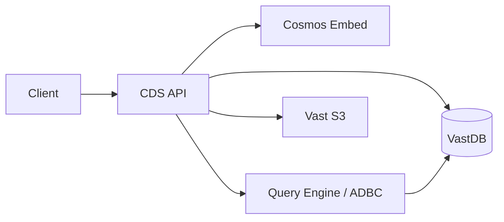
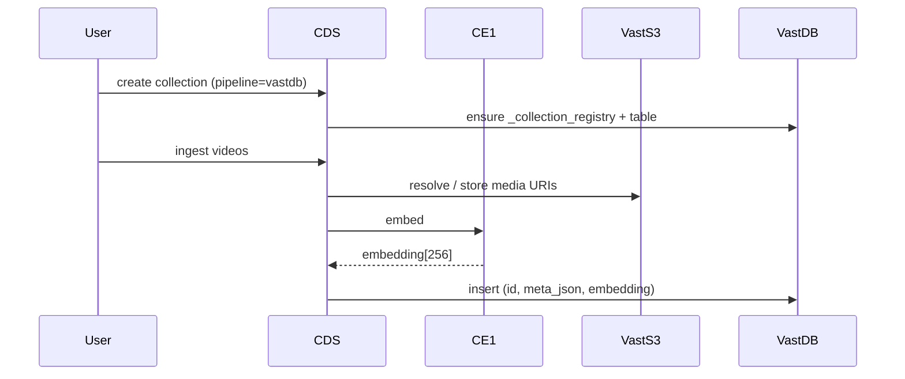
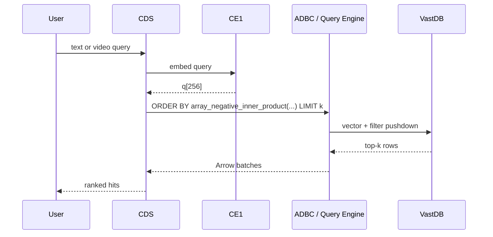
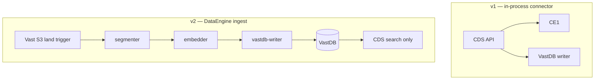

# Running NVIDIA Cosmos Dataset Search on VastDB

*Technical blog — Cosmos Dataset Search with VAST Database and Vast S3.*

NVIDIA’s [Cosmos Dataset Search (CDS)](https://build.nvidia.com/nvidia/cosmos-dataset-search/blueprintcard)
blueprint gives robotics and AV teams a production-shaped path for
text-to-video and video-to-video search: Cosmos Embed for unified embeddings,
a visual-search API for collections and queries, and a vector database for
similarity search.

This branch runs that blueprint entirely on the VAST AI OS:

- **VastDB** for vectors and collection metadata
- **Vast S3** for videos and frames
- Optional **VAST DataEngine** for serverless ingest (recommended next step)

There is no separate ANN service and no S3 emulator in the Compose stack.

---

## Architecture



| Layer | This branch |
| --- | --- |
| Embeddings | Cosmos Embed CE1 (256-d) |
| Vector store | VastDB tables |
| Similarity | Query Engine `array_*` distance SQL |
| Collection meta | VastDB `_collection_registry` |
| Media | Vast S3 |
| Pipeline id | `cosmos_video_search_vastdb` |

See [VAST Vector Search](https://www.vastdata.com/blog/introducing-vast-vector-search-real-time-ai-retrieval-without-limits)
and the [Vector Search administrator guide](https://kb.vastdata.com/documentation/docs/vector-search-55).

---

## Ingest path



---

## Search path



Writes use the [vastdb Python SDK](https://github.com/vast-data/vastdb_sdk).
Searches use the [ADBC driver](https://github.com/vast-data/vastdb-adbc-driver).

---

## Try it

```bash
git checkout feature/vastdb-vector-store
cd deploy/standalone
cp .env.example .env   # fill VASTDB_* and VAST_S3_*

docker compose \
  -f docker-compose.build.yml \
  -f docker-compose.ce1-oss.yml \
  up -d cosmos-embed visual-search

cds collections create \
  --pipeline cosmos_video_search_vastdb \
  --name "demo-vastdb"
```

Guides: [VastDB vector store](../docs/vastdb-vector-store.md) ·
[Architecture](../docs/vastdb-architecture.md).

---

## Room for DataEngine serverless processing



**Good candidates for DataEngine functions**

1. Segment / clip videos as objects land on Vast S3
2. Call CE1 per segment
3. Write vectors with a `vastdb-writer` function ([VSS blueprint](https://github.com/vast-data/vss-blueprint))
4. Enrichment: tags, ACL columns, quality filters before training retrieval

---

## References

- [CDS blueprint card](https://build.nvidia.com/nvidia/cosmos-dataset-search/blueprintcard)
- [VAST Vector Search blog](https://www.vastdata.com/blog/introducing-vast-vector-search-real-time-ai-retrieval-without-limits)
- [VAST Vector Search solution brief](https://www.vastdata.com/resources/solution-briefs/vast-vector-search)
- [Vector Search KB](https://kb.vastdata.com/documentation/docs/vector-search-55)
- [Query Engine KB](https://kb.vastdata.com/documentation/docs/vast-query-engine)
- [vastdb SDK](https://github.com/vast-data/vastdb_sdk)
- [vastdb ADBC driver](https://github.com/vast-data/vastdb-adbc-driver)
- [VSS blueprint](https://github.com/vast-data/vss-blueprint)
