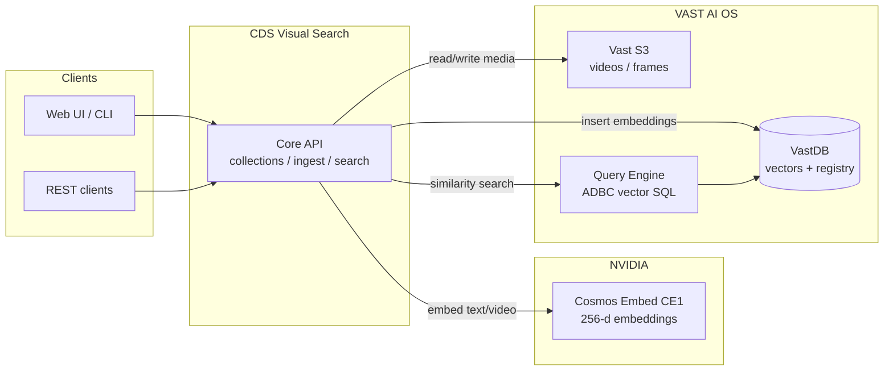
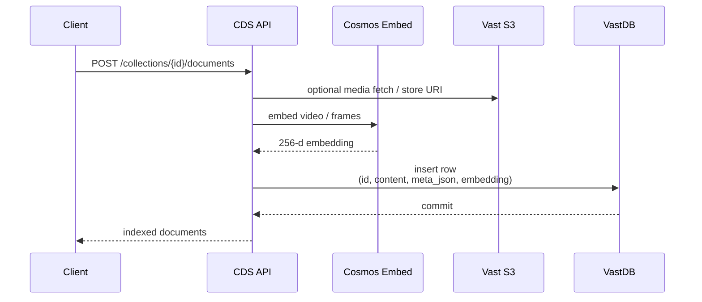
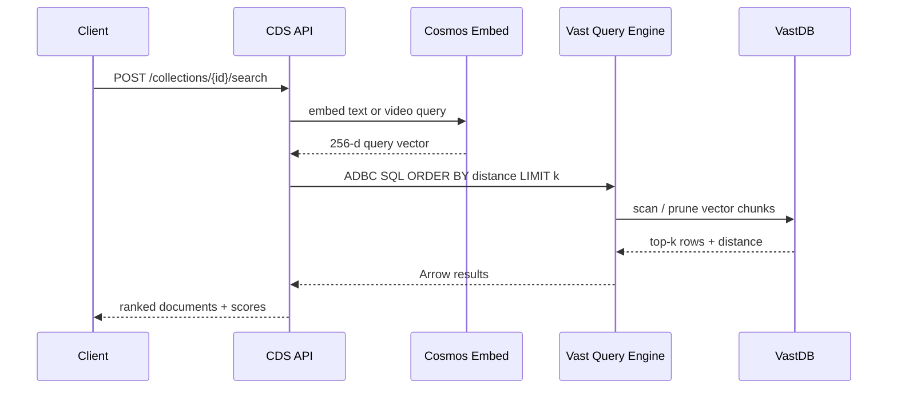
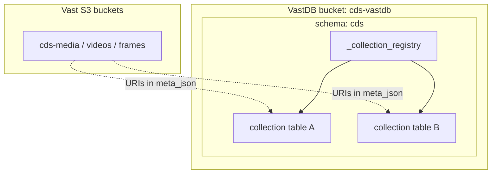
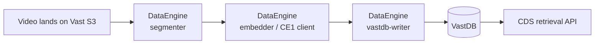

# VastDB architecture for Cosmos Dataset Search

This page describes how CDS runs when the vector backend is **VastDB** and
media lives on **Vast S3**. Compare with the stock [VastDB architecture](architecture.md).

## System overview

**What changed vs VastDB CDS**

- Removed: VastDB, etcd, Vast S3/MinIO (for the VastDB profile).
- Added: VastDB tables + ADBC Query Engine path.
- Replaced: object storage endpoint → Vast S3 (same S3 API, VAST-backed).
- Unchanged: CE1, CDS REST/CLI contracts, collection CRUD semantics.

## Ingest flow

Each collection maps to one VastDB table:

| Column | Type | Role |
| --- | --- | --- |
| `id` | string | Document primary key |
| `content` | string | Optional text payload |
| `meta_json` | string | Dynamic CDS document metadata |
| `embedding` | `list<float32>[256]` | CE1 vector |

Collection records (name, pipeline, tags, …) live in `_collection_registry`.

## Search flow

Distance functions (see
[Vector Search docs](https://kb.vastdata.com/documentation/docs/vector-search-55)):

| CDS similarity | VastDB SQL |
| --- | --- |
| `IP` / `dot_product` | `array_negative_inner_product` |
| `cosine` | `array_cosine_distance` |
| `l2` / `euclidean` | `array_distance` |

## Storage layout on VAST

## Optional: DataEngine serverless ingest

For hyperscale or continuous video landing, push heavy ingest off the CDS API
node onto **VAST DataEngine** (same pattern as the
[VSS blueprint](https://github.com/vast-data/vss-blueprint)):

**When this helps**

- Billions of clips / long-running curation (Figure AI–style loops).
- Burst ingest without sizing the CDS API replica set for peak CPU.
- Reuse of existing VAST event triggers and identity policies.

**What stays in CDS**

- Collection registry semantics, search API, CE1 query embedding, UI/CLI.

This repository ships the **in-process VastDB connector** first. A starter
DataEngine pipeline is documented as a follow-on (see the blog).

## Component map

| CDS component | VastDB path |
| --- | --- |
| Pipeline | `cosmos_video_search_vastdb` |
| Document store | `src/haystack/components/vastdb/document_store.py` |
| Writer | `VastDocumentWriter` |
| Retriever | `VastEmbeddingRetriever` |
| Compose overlay | `deploy/standalone/docker-compose.vastdb.yml` |
| Env template | `deploy/standalone/.env.vastdb.example` |

## Further reading

- Customer how-to: [VastDB vector store](vastdb-vector-store.md)
- [VAST Vector Search announcement](https://www.vastdata.com/blog/introducing-vast-vector-search-real-time-ai-retrieval-without-limits)
- [Vector DB Quickstart](https://vast-data.github.io/data-platform-field-docs/vast_vectordb/quickstart-new.html)
- [vastdb SDK](https://github.com/vast-data/vastdb_sdk) · [ADBC driver](https://github.com/vast-data/vastdb-adbc-driver)
